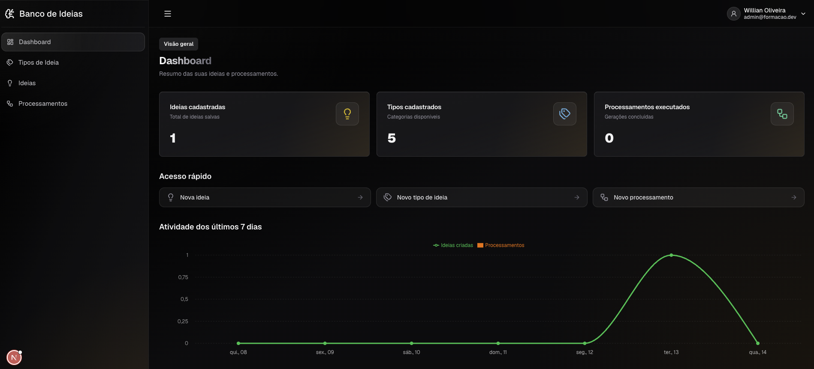

# Banco de Ideias

**Capture ideias, processe com IA e reaproveite quantas vezes precisar.**



O Banco de Ideias é uma aplicação web para registrar ideias, organizá-las por tipo e usar Inteligência Artificial para transformá-las em conteúdo pronto. Cada tipo de ideia carrega um prompt especializado, que orienta a geração de conteúdos como roteiros para redes sociais, roteiros virais, VSLs e resumos.

O usuário pode gerar diferentes resultados a partir da mesma ideia, pedir refinamentos e acompanhar o histórico de cada geração. Cada pessoa tem sua própria conta e acessa apenas os próprios dados.

## Como funciona

1. **Escolha um tipo de ideia:** crie uma categoria com um prompt próprio ou importe os tipos pré-definidos disponíveis para começar.
2. **Capture a ideia:** registre o nome, a descrição e o objetivo, adicionando textos de apoio para enriquecer o contexto.
3. **Processe com IA:** transforme a ideia em conteúdo usando o prompt do tipo escolhido.
4. **Refine o resultado:** solicite ajustes e acompanhe as versões no histórico do processamento.
5. **Acompanhe sua atividade:** consulte o dashboard para visualizar seus registros e acessar as ações mais comuns.

## Módulos de negócio

O produto é organizado em dois módulos: **Autenticação** e **Ideias**.

### Autenticação

Cuida do cadastro de contas e da verificação de credenciais no login. Garante que cada usuário acesse apenas os próprios dados. A manutenção da sessão fica a cargo da camada técnica da aplicação.

O domínio está em [`modules/auth`](modules/auth). As regras de negócio estão descritas em [Autenticação](.specs/memory/modules/auth.md).

### Ideias

É o núcleo do produto e reúne quatro áreas relacionadas:

| Área | O que faz |
| --- | --- |
| **Tipos de Ideia** | Organiza categorias com prompts especializados, incluindo uma biblioteca de tipos pré-definidos para iniciar o uso. |
| **Ideias** | Registra a ideia, sua descrição, seu objetivo e recursos de contexto em texto. |
| **Processamentos** | Gera conteúdo com IA e mantém o histórico dos refinamentos de cada resultado. |
| **Dashboard** | Mostra contagens, atividade recente, últimas ideias atualizadas e atalhos para as ações comuns. |

Cada processamento preserva uma cópia dos dados da ideia, dos recursos e do prompt utilizados na geração. Editar a ideia ou o tipo depois não altera os processamentos anteriores. A mesma ideia pode dar origem a vários processamentos independentes.

O domínio está em [`modules/ideas`](modules/ideas). As regras de negócio estão descritas em [Ideias](.specs/memory/modules/ideas.md).

## Integração com Inteligência Artificial

A IA oferece geração e refinamento de texto, além da transcrição de voz para apoiar o preenchimento dos campos. Os resultados dos processamentos são apresentados em Markdown.

Essa integração é uma camada de infraestrutura. O domínio consome um contrato abstrato, permitindo trocar o provedor de IA sem alterar as regras de negócio. A implementação atual utiliza a OpenAI.

## Tecnologias e organização

O projeto utiliza TypeScript em um monorepo com npm workspaces e Turborepo.

- **Frontend:** Next.js, React e Tailwind CSS.
- **Backend:** NestJS, Prisma e PostgreSQL.
- **Autenticação:** JWT e bcrypt.
- **Testes:** Jest.

```text
apps/
  frontend/                 # Interface web
  backend/                  # API e integrações
modules/
  auth/                     # Regras de negócio de autenticação
  ideas/                    # Regras de negócio de ideias e processamentos
packages/
  shared/                   # Entidades, validações e contratos compartilhados
  eslint-config/            # Configuração de lint
  typescript-config/        # Configuração de TypeScript
.specs/                     # Documentação e especificações do projeto
```

Os módulos de negócio mantêm suas regras independentes de HTTP, do banco de dados e do provedor de IA. As aplicações conectam essas regras à interface e às integrações necessárias.

## Documentação

- [Visão do produto](.specs/memory/produto.md)
- [Visão geral dos módulos](.specs/memory/modulos.md)
- [Contexto técnico](.specs/memory/contexto-tecnico.md)
- [Estrutura do projeto](.specs/memory/estrutura.md)
